# Architecture

How the organ is put together: where things live, how sound flows, and what state
exists. For *why* things are built this way, see [decisions.md](decisions.md).

## Files

| Path | What it is |
| --- | --- |
| `index.html` | The whole instrument: markup, CSS (`<style>`) and the Web Audio script (one `<script>`, wrapped in an IIFE). |
| `scripts/check.mjs` | Static checks: document shape, script syntax, element ids, allowed external hosts. |
| `.github/workflows/check.yml` | Runs the static checks and the browser tests on every PR and on `main`. |
| `tests/` | Playwright tests that play the organ and measure its sound. See `tests/README.md`. |
| `scripts/serve.mjs` | A dependency-free static server for local play and tests (`npm run serve`). |
| `package.json` | Development tooling only (Playwright). The site itself needs no install. |
| `docs/` | This file and the decision log. |

GitHub Pages serves the root of `main` directly; there is no build step.

## Signal flow

```mermaid
flowchart LR
  subgraph Voice["Per key (voice)"]
    O1["5 oscillators<br/>one per rank"] --> E1["envelope gains"]
    WP["windPitch<br/>(cents)"] --> WR["per-reed gain<br/>v.winds[i]"] --> O1
  end
  E1 --> B["rank buses<br/>buses.bass[i] / buses.treble[i]"]
  B --> SW["swell lowpass<br/>(lid / sweep)"] --> TL["tilt high-shelf"] --> WG["wind gain"] --> TR["trem gain"]
  N["breath noise"] --> TR
  TR --> FIN
  subgraph FAN["Fan stage (Vox Humana)"]
    FIN["fanIn"] --> LP["fanLow lowpass<br/>(Blade size)"] --> SUM["fanOut"]
    FIN --> HB["upper band<br/>(in − low)"]
    LP -- "× −1" --> HB
    HB --> SH["shadow gain"] --> HP["hiPan"] --> SUM
    HB --> RF["refl delay"] --> RG["reflGain"] --> SH
  end
  SUM --> EQ["body EQ<br/>230 Hz, 1.1 kHz, 6 kHz shelf"] --> CAB["cabinet convolver<br/>dry / wet"] --> ROOM["room convolver<br/>dry / wet"] --> CMP["compressor"] --> OUT["master → speakers"]
```

Modulators (all audio-rate `AudioParam` connections):

- `lfo` (Vox Humana blade wave: sine, or a two-blade Fourier wave) → `lfoShadow` → `shadow.gain`; → `lfoAmp` → `trem.gain` (Whole-sound wobble); → `lfoFilt` → `swell.detune` (Lid wobble).
- `lfoPan` (cosine, started at the same instant as `lfo` so they stay phase-locked) → `lfoRefl` → `refl.delayTime`; → `lfoPanAmt` → `hiPan.pan`.
- `windPitch` (a `ConstantSource`, in cents) → each reed's own gain → that oscillator's `detune`.

## Control loop

`frame()` runs on `requestAnimationFrame` and is the only place time-varying
physics is simulated:

1. Step both treadle ADSR envelopes (`stepEnv`).
2. Reservoir: `pressure += (inflow − drain) · dt / reservoirSize`. Inflow comes from the treadles (alternating feet fill better) and the helper pump. Drain grows with sounding reeds and the knee swell. Pressure is clamped to 0–1, and the relief valve vents at 1.
3. Smooth the knee swell (`swellPos`) and the tone pressure (`tonePress`, Response time).
4. Push targets into the audio graph: wind gain (`windLevel`, with a knee at 2″), lid/tilt filter (depending on the tone model), `windPitch` offset (Pitch drift), breath noise level.
5. Update the gauge, treadle visuals and readouts (readouts at 10 Hz).

Pressure is 0–1; the gauge shows `pressure × 3.6″`. The reference pressure `P_REF = 0.55` (about 2″) is where reeds are "in tune" and where tone and pitch offsets are zero.

## A voice

`noteOn(m)` creates one voice per key: five oscillators, one per rank, even if
the stop is off. Stops only change bus gains, so a stop drawn mid-chord comes in
immediately. Each oscillator gets:

- frequency `f × rank.mult`, using the rank's own `PeriodicWave` (`rankWave(i)`);
- `detune` = `rankCents(i, f, m)` (Celeste beat or rank det, plus voicing tune, plus `reedScatter`), with a pitch scoop from below;
- its own wind-response gain from `windPitch` (`reedWindResp`);
- an envelope gain whose attack slows with low wind (Speech speed);
- routing to `buses[halfOf(m)][i]`.

Voices are reference-counted (`refs`). Input never calls `noteOn` directly: it
calls `press(m)` / `release(m)`, which add coupled octaves. `recouple()` updates
held keys when a coupler is drawn or retired.

## State and persistence

- **Stops** (`stops.bass[id]`, `stops.treble[id]`, `stops.vox`, `stops.sub`, `stops.sup`) are not saved; the organ always opens with Diapason and Melodia drawn.
- **Settings** are saved in `localStorage` under `reed-<key>` through `store.get` / `store.set`. Most use `bindSlider(id, key, default, format, onChange, map)`: the input id ends in `Amt`, its `<output>` in `Out`, and `map` turns the slider position into the value the sound uses.
- **Reed set**: `reedSeed` (saved) feeds `reedRand(i, m, salt)`, a hash used for each reed's tuning error and wind response.

## Where features live (search for these names)

| Feature | Key names |
| --- | --- |
| Ranks and waveforms | `RANKS`, `WAVE_SPECS`, `rankRecipe`, `rankWave`, `loudComp` |
| Rank voicing drawer | `voicing`, `rankLevel`, `rankCents`, `retune`, `revoice` |
| Individual reeds | `reedRand`, `reedTri`, `reedScatter`, `reedWindResp`, `rewind`, `reedSeed` |
| Celeste | `celesteCents`, `beatS` |
| Divided stops | `SPLITS`, `splitMode`, `halfOf`, `renderStops` |
| Couplers | `press`, `release`, `recouple`, `couplesFor` |
| Wind and treadles | `frame`, `ped`, `stepEnv`, `gateOn`, `gateOff`, `windLevel`, `windBright`, `KNEE` |
| Wind tone | `toneModel`, `TONE_MODELS`, `tilt`, `swell`, `tonePress` |
| Vox Humana | `applyVox`, `setFanShape`, `fanWaves`, `lfoFreq`, `fanLow`, `shadow`, `refl`, `hiPan` |
| Case and room | `cabinetIR`, `impulse`, `applyMix` |
| MIDI | `connectMidi`, `onMidi` (notes, CC64 sustain, CC11/CC4 swell, CC120/123) |
