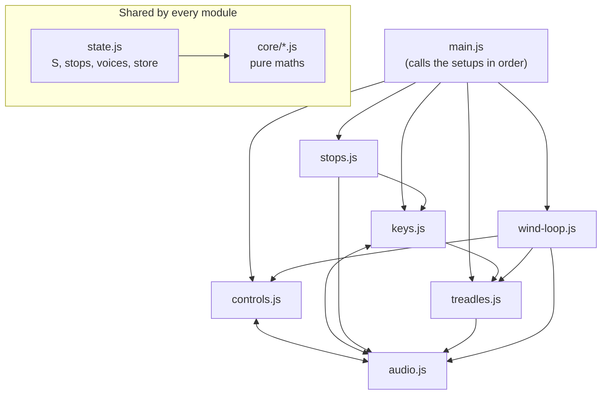
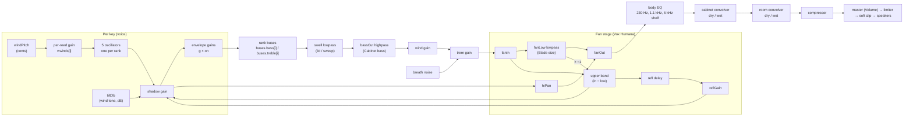

# Architecture

How the organ is put together: where things live, how sound flows, and what state
exists. For *why* things are built this way, see [decisions.md](decisions.md).

## Files

| Path | What it is |
| --- | --- |
| `index.html` | The markup: cabinet with a top bar (name, gauge, Volume/MIDI/All notes off), stop rail with the Rank voicing, Vox Humana fan and Expression drawers, the wind status line under the gauge, Knee swell, keyboard, treadle area, Adjustments, notes. Loads `css/organ.css` and `js/main.js`. |
| `css/organ.css` | All styles. Colour tokens are in the `:root` block at the top. |
| `js/main.js` | Entry point: calls each module's setup in order (see below). |
| `js/state.js` | Shared state: `S` (pressure, swell, tone and the saved choices), `stops`, `voices`, `store` (localStorage), `halfOf`. |
| `js/controls.js` | Every slider and setting: `bindSlider`, the `ctl` object the sound reads, `mix`, the rank-voicing drawer. |
| `js/audio.js` | The Web Audio graph, voices (`noteOn`/`noteOff`), and everything that pushes settings into the sound (`applyStops`, `applyVox`, `applyWind`, `retune`, …). |
| `js/keys.js` | On-screen keyboard, octave couplers (`press`/`release`/`recouple`), computer keys, MIDI. |
| `js/stops.js` | Stop rail and the divided-stops selector. |
| `js/treadles.js` | The two treadles: ADSR state (`ped`), pedals, envelope pictures, `gateOn`/`gateOff`. |
| `js/info.js` | The info buttons: `setupInfo()` adds an "i" button to every `[data-info]` section's `.info-host` heading, which shows or hides that section's own `.sub` and `.hint` text (D24). |
| `js/autoplay.js` | Pedal autoplay: the pattern editor, its saved pattern, and `stepAutoplay()`, which the control loop calls each frame to press and lift the treadles through `gateOn`/`gateOff`. |
| `js/wind-loop.js` | The per-frame control loop (`frame`), the gauge and readouts. |
| `js/core/*.js` | Pure maths, with no page or audio access: `ranks.js` (ranks, harmonic recipes, brightness compensation, Celeste), `reeds.js` (per-reed scatter, wind response and Unison pull), `wind.js` (loudness, brightness and pitch against pressure, treadle envelopes), `speech.js` (how a reed speaks: onset time and shape, tone bloom, the tone shelf's position), `fan.js` (the spinning-fan wave), `expression.js` (the scoop curves and which notes scoop, the vibrato's delay, fade-in, natural variation and wander curve, the delay controller's mapping, the pitch wheel's range), `output.js` (volume, cabinet bass corner, limiter make-up, soft clip), `autoplay.js` (meters, pattern editing and reshaping, which treadle is down at a given time). |
| `tests/*.spec.js` | Playwright tests that play the organ and measure its sound. See `tests/README.md`. |
| `tests/unit/` | Unit tests for `js/core` (`npm run test:unit`, no browser). |
| `scripts/check.mjs` | Static checks: page shape, referenced files, module syntax, imports resolve to real exports, element ids, allowed external hosts. |
| `scripts/serve.mjs` | A dependency-free static server for local play and tests (`npm run serve`). |
| `.github/workflows/check.yml` | Runs the checks, unit tests and browser tests on every PR and on `main`. |
| `package.json` | Development tooling only (Playwright). The site itself needs no install or build. |
| `docs/` | This file and the decision log. |

GitHub Pages serves the root of `main` directly; there is no build step. The
browser loads the modules natively, which needs HTTP: to play locally, run
`npm run serve` and open http://localhost:8080/ (opening the file directly
won't work).

## How the modules fit together

Some modules import each other in a loop (`audio` and `controls`, `audio` and
`keys`). That's safe because **modules do no work when they load**: they only
define constants and functions. All work happens in the setup functions, which
`main.js` calls in this order once every module has loaded:

1. `setupControls()`: binds sliders and selects, builds the voicing drawer, fills `ctl` and `mix`.
2. `setupStops()`: draws the stop rail.
3. `setupKeys()`: builds the keyboard and attaches pointer, computer-key and MIDI input.
4. `setupTreadles()`: builds the pedals and envelope controls.
5. `setupAutoplay()`: builds the pedal autoplay editor from the saved pattern.
6. `setupInfo()`: adds the info buttons and hides the explanations each section has hidden.
7. `startWindLoop()`: draws the gauge and starts `frame()`.

Keep it that way. If a module needs something at load time, it may only use
`js/core` and `state.js`, which don't import anything else. The audio graph is
built later, on the first key, slider or pedal touch (`initAudio`), because
browsers only allow sound after the player interacts.

## Signal flow

Modulators (all audio-rate `AudioParam` connections):

- `lfo` (Vox Humana blade wave: sine, or a two-blade Fourier wave) → `lfoShadow` → `shadow.gain`; → `lfoAmp` → `trem.gain` (Whole-sound wobble); → `lfoFilt` → `swell.detune` (Lid wobble).
- `lfoPan` (cosine, started at the same instant as `lfo` so they stay phase-locked) → `lfoRefl` → `refl.delayTime`; → `lfoPanAmt` → `hiPan.pan`.
- `windPitch` (a `ConstantSource`, in cents) → each reed's own gain → that oscillator's `detune`.
- `tiltDb` (a `ConstantSource`, in dB) → every reed's tone shelf `gain`, added to the shelf's own onset automation (Tone bloom).
- `pitchBend` (a `ConstantSource`, in cents, from the MIDI pitch wheel) → every oscillator's `detune` (D28).
- Each voice's `bend.src` (a `ConstantSource`, in cents) → all five of its oscillators' `detune`: the Expression scoop, a value curve from −depth to exactly 0 (D28).
- Each voice's `vib.lfo` (sine, D29) → `vib.env` (0 through the delay, then the fade-in curve to 1) → `vib.depth` (cents) → all five oscillators' `detune`, and → `vib.colour` (dB) → each reed's tone shelf `gain`. `rateWander` and `depthWander` (shared looping buffers of `wanderCurve`) → each voice's `vib.rateWander` → `lfo.frequency` and `vib.depthWander` → `vib.depth.gain`.

## Control loop

`frame()` runs on `requestAnimationFrame` and is the only place time-varying
physics is simulated:

1. Pedal autoplay (`stepAutoplay`): works out which treadle the pattern holds down now (`pedalsAt`) and calls `gateOn`/`gateOff` on changes. It does nothing until the audio context exists (the player's first touch). Then step both treadle ADSR envelopes (`stepEnvelope`).
2. Reservoir: with Direct wind on (D26), pressure glides to the slider's value and nothing else moves it. Otherwise `pressure += (inflow − drain) · dt / reservoirSize`. Inflow comes from the treadles (alternating feet fill better) and the helper pump. Drain (`windDrain`) grows with sounding reeds and the knee swell; with Easy wind it counts at most three reeds (D23). Pressure is clamped to 0–1, and the relief valve vents at 1.
3. Smooth the knee swell (`swellPos`) and the tone pressure (`tonePress`, Response time).
4. `applyWind()` pushes targets into the audio graph: wind gain (`windLevel`, with a knee at 2″), lid filter and `tiltDb` (depending on the tone model; each reed's own shelf applies the tilt, D17), `windPitch` offset (`windCents`: flat as the wind rises, D12), breath noise level.
5. Update the gauge, treadle visuals and readouts (readouts at 10 Hz).

Pressure is 0–1; the gauge shows `pressure × 3.6″`. The reference pressure `P_REF = 0.55` (about 2″) is where reeds are "in tune" and where tone and pitch offsets are zero.

## A voice

`noteOn(m)` creates one voice per key: five oscillators, one per rank, even if
the stop is off. Stops only change bus gains, so a stop drawn mid-chord comes in
immediately. Each oscillator gets:

- frequency `f × rank.mult`, using the rank's own `PeriodicWave` (`rankWave(i)`);
- `detune` from `keyTuning(f, m, half)`: each rank's `rankCents(i, f, m)` (Celeste beat or rank det, plus voicing tune, plus `reedError`), with drawn non-Celeste ranks inside the Unison pull range locked to their average (`lockReeds`, D14); the note starts Speech glide cents sharp and settles (D13);
- its own wind-response gain from `windPitch` (`reedWindResponse`, averaged across a locked group);
- a start time offset by part of its own cycle, so it starts at its own phase (locked reeds nearly together, D14);
- a high-shelf tone filter at 1.5 × its own frequency (`TILT_RATIO`). Its gain starts Tone bloom dB down and opens as the reed speaks, `BLOOM_LAG` × slower than the amplitude; `tiltDb` adds the wind's tilt (D17);
- two envelope gains, `g` (which also carries the release) and `on`, each rising with the same time constant, so the onset is (1 − e^(−t/τ))²: S-shaped, slower for lower reeds and lower wind (`speechTime`, `onsetTau` in `core/speech.js`, D16);
- routing to `buses[halfOf(m)][i]`.

`noteOn(m, expr)` also takes the press's Expression (D28, D29): `{cents, dur, curve, top, vib}`. When `cents > 0` the voice gets one `bend` source, shared by all its oscillators, that starts `cents` below and follows `scoopCurve` to exactly 0 over `dur`. When `vib` is set, `makeVib` gives it a delayed vibrato whose delay counts from the landing (`t + dur`, or `t` without a scoop); `scheduleVib` (re)schedules it from the current sliders, and `applyVibrato` does that for every sounding note when a vibrato slider or the learned delay controller moves. `press(m, velocity)` decides the Expression once per played key (`expressionFor`: top voice, leaps, velocity, accents, the scoop's duration from the played key's speech time, and the chord window that calls `unscoop` on a lower note when a higher one arrives within `CHORD_WINDOW`) and passes the same object to every coupled octave. With vibrato on the top voice, a new top note calls `dropVibrato` on the previous one (`vibSet`).

`retune()` recomputes `keyTuning` for every sounding voice and updates all ranks' detune and wind gains; it runs on tuning, Celeste, scatter, Unison pull, Drift variation and new-reed changes, and from `applyStops()`, because drawing a stop can lock or unlock reeds. `rewind` is the same function.

Voices are reference-counted (`refs`). Input never calls `noteOn` directly: it
calls `press(m)` / `release(m)`, which add coupled octaves. `recouple()` updates
held keys when a coupler is drawn or retired.

## State and persistence

- **Stops** (`stops.bass[id]`, `stops.treble[id]`, `stops.vox`, `stops.sub`, `stops.sup`) are not saved; the organ always opens with Diapason and Melodia drawn.
- **Settings** are saved in `localStorage` under `reed-<key>` through `store.get` / `store.set`. Most use `bindSlider(id, key, default, format, onChange, map)` in `controls.js`: the input id ends in `Amt`, its `<output>` in `Out`, and `map` turns the slider position into the value the sound uses. Add the result to `ctl` so other modules can read `ctl.name.value`.
- **Saved choices** that aren't sliders (`S.splitMode`, `S.compass`, `S.easyWind`, `S.directWind`, `S.toneModel`, `S.voxShape`, `S.scoopMode`, `S.scoopCurve`, `S.vibMode`, `S.vibCC`, `S.reedSeed`) are read once in `state.js`. `S.wheel` holds the MIDI pitch wheel's last position and isn't saved.
- **Reed set**: `S.reedSeed` feeds `reedRand(seed, i, m, salt)`, a hash used for each reed's tuning error and wind response.

## Where features live

| Feature | Files | Key names |
| --- | --- | --- |
| Ranks and waveforms | `core/ranks.js`, `audio.js` | `RANKS`, `WAVE_SPECS`, `waveRecipe`, `rankWave`, `loudnessComp`, `updateComp` |
| Rank voicing drawer | `controls.js`, `audio.js` | `ctl.voicing`, `rankLevel`, `rankCents`, `retune`, `revoice` |
| Individual reeds | `core/reeds.js`, `audio.js`, `controls.js` | `reedRand`, `reedTri`, `reedError`, `reedWindResponse`, `rewind`, `S.reedSeed` |
| Unison pull and start phase | `core/reeds.js`, `audio.js`, `controls.js` | `lockReeds`, `keyTuning`, `retune`, `ctl.pull` |
| Celeste | `core/ranks.js` | `celesteCents`, `ctl.beat` |
| Divided stops | `core/ranks.js`, `stops.js`, `state.js` | `SPLITS`, `S.splitMode`, `halfOf`, `renderStops` |
| Couplers | `keys.js` | `press`, `release`, `recouple`, `couplesFor` |
| Wind and treadles | `wind-loop.js`, `treadles.js`, `core/wind.js` | `frame`, `ped`, `stepEnvelope`, `gateOn`, `gateOff`, `windLevel`, `windBright`, `windCents`, `KNEE` |
| Wind tone | `audio.js`, `controls.js`, `core/speech.js` | `applyWind`, `S.toneModel`, `TONE_MODELS`, `tiltDb`, `TILT_RATIO`, `swell`, `S.tonePress` |
| Speech and Tone bloom | `core/speech.js`, `audio.js`, `controls.js` | `speechTime`, `windSpeech`, `onsetTau`, `BLOOM_LAG`, `ctl.speech`, `ctl.bloom` |
| Vox Humana | `audio.js`, `core/fan.js`, `controls.js` | `applyVox`, `setFanShape`, `fanWaveCoefficients`, `lfoFreq`, `fanLow`, `shadow`, `refl`, `hiPan` |
| Case and room | `audio.js` | `cabinetIR`, `impulse`, `applyMix`, `mix` |
| Direct wind | `wind-loop.js`, `controls.js`, `autoplay.js`, `keys.js`, `state.js` | `S.directWind`, `ctl.directAir`, `#directOn`, `#airAmt`, MIDI CC2 and `S.directCC` (CC7 by default; `#directLearn`, `setDirectCC`) |
| Easy wind | `core/wind.js`, `wind-loop.js`, `treadles.js`, `state.js` | `windDrain`, `EASY_REEDS`, `S.easyWind`, `#easyWind` |
| Pedal autoplay | `autoplay.js`, `core/autoplay.js`, `controls.js`, `wind-loop.js` | `stepAutoplay`, `setupAutoplay`, `retime`, `pedalsAt`, `noteAt`, `reshape`, `METERS`, `ctl.tempo`, store key `autoplay` |
| MIDI | `keys.js` | `connectMidi`, `onMidi` (notes with velocity, pitch wheel, CC1 Scoop, a learned CC for Vibrato delay, CC64 sustain, CC11/CC4 swell, CC7 volume or Direct wind, CC2 Direct wind, CC120/123); MIDI Learn for Direct wind and Vibrato delay (`LEARN`, `setLearned`, `showCC`) |
| Expression (scoop, vibrato, pitch wheel) | `core/expression.js`, `keys.js`, `audio.js`, `controls.js`, `state.js` | `scoopCurve`, `scoopDepth`, `scoopDuration`, `bendCents`, `CHORD_WINDOW`, `KEY_VELOCITY`, `vibStart`, `vibFadeCurve`, `vibStartRate`, `wanderCurve`, `delayFromCC`, `expressionFor`, `press(m, velocity)`, `noteOn(m, expr)`, `unscoop`, `makeVib`, `scheduleVib`, `applyVibrato`, `dropVibrato`, `applyBend`, `pitchBend`, `rateWander`, `depthWander`, `ctl.scoopDepth`, `ctl.scoopTime`, `ctl.scoopCross`, `ctl.vibDepth`, `ctl.vibRate`, `ctl.vibDelay`, `ctl.vibFade`, `ctl.vibNatural`, `ctl.vibColour`, `ctl.bendRange`, `#exprPanel`, `#vibLearn` |
| All notes off | `keys.js`, `audio.js` | `allNotesOff`, `silenceAll`, `#panicBtn`, Escape; computer keys tracked by `KeyboardEvent.code` (`CODEMAP`, `keyId`) |
| Compass | `keys.js`, `state.js` | `COMPASS`, `inCompass`, `couplesFor`, `S.compass` |
| Volume, limiter, cabinet bass | `audio.js`, `core/output.js`, `controls.js` | `applyOutput`, `master`, `MASTER`, `limiterMakeupDb`, `softClipCurve`, `bassCut`, `ctl.volume`, `ctl.bassCut` |
| Knee swell range | `audio.js` | `SWELL_CLOSED`, `SWELL_OPEN` |
